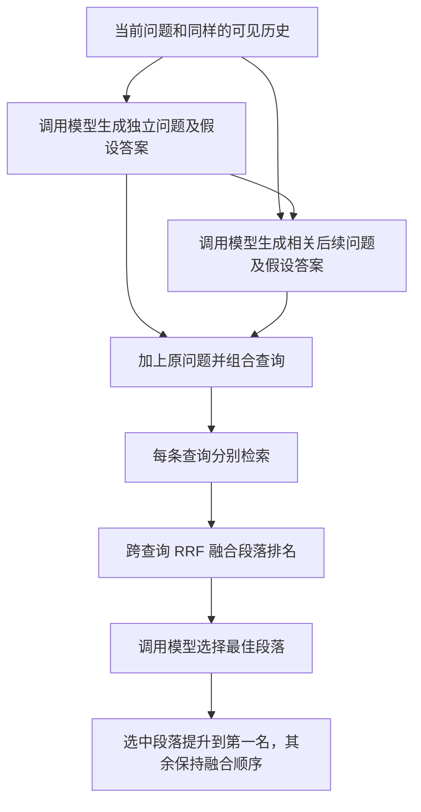

# C · CompCQR 组合查询说明

本文件解释新增 C 的理论流程、代码位置、评测口径和运行方法。A 是直接重写，B 是结构化重写，C 是 CompCQR 的本地适配实现。方法来源为 [CompCQR 论文](https://aclanthology.org/2026.findings-emnlp.1225/) 和 [官方代码](https://github.com/YunahJang/CompCQR)。

## 1. C 怎样执行



| 组件 | 字段 | 内容 |
| --- | --- | --- |
| 原始问题 | `oq` | 当前用户问题 |
| 独立改写 | `mq` | 根据当前问题和可见历史补全的独立问题 |
| 假设答案 | `ma` | 模型生成的查询扩展材料 |
| 后续问题 | `mq2` | 模型生成的相关追问 |
| 后续假设答案 | `ma2` | 对生成追问的假设回答 |

组件生成的输入仅限当前问题、可见历史及本轮已生成组件。假设答案可能使用模型已有知识，不能保证事实正确。模型看不到当前轮人工重写、参考答案、相关段落 ID 或真实下一轮问题。假设答案只用于检索扩展。完整问答生成仍使用实际检索段落作为证据。

五个非空组件在 dense/hybrid 下进行不重复排列，最多得到 `5 + 20 + 60 + 120 + 120 = 325` 条查询。BM25 对组件顺序不敏感，因此使用最多 31 个非空组件子集。空组件和相同查询会被去掉，实际数量以 `rewrite_trace.query_count` 为准。

每条查询检索一定深度，按原始 `passage_id` 合并相同段落。跨查询的 RRF 分数为各路 `1 / (s + rank)` 之和，默认 `s=0`，同分先比较出现频次，再使用稳定 ID 排序。最后让模型在预算内的候选段落中选择一个编号，选中的段落移到第一名，其余维持融合相对顺序。

## 2. 与项目混合检索的关系

真实模式继续使用 BM25 与 bge-m3 混合检索。A/B/C 所有查询共享 `hybrid_candidate_depth=400`，即内部两路各取最多 400 个候选，防止最终 Top-K 或 C 的内部检索深度改变融合候选范围。该排名参数不改变已保存的文档向量。有两层融合，各自处理不同对象。

| 层次 | 融合对象 | 当前常数 |
| --- | --- | ---: |
| 每条查询内部 | BM25 排名和向量排名 | 60 |
| 多查询之间 | 不同组合查询返回的段落排名 | `compcqr_rrf_k`，默认 0 |

当前 QReCC 数据仍是 307 道题和 9,975 个段落。相同语料、向量模型权重和索引配置可以复用已有索引，加入 C 本身不要求重新向量化文档。查询向量按批处理，文档向量继续复用。已安装 NumPy 时使用可选的矩阵计算加速，未安装时保留标准库回退路径。

## 3. 参数与论文差异

| 配置键 | 默认值 | 作用 |
| --- | ---: | --- |
| `compcqr_max_components` | 5 | 一条组合查询最多使用多少个组件；5 对应完整排列 |
| `compcqr_retrieval_depth` | 100 | 每条查询取多少个结果，独立于最终展示或评分的 Top-3/Top-5 |
| `compcqr_rrf_k` | 0 | 跨查询融合的平滑常数 |
| `compcqr_selection_top_k` | 5 | 最多给模型多少个候选段落 |
| `compcqr_passage_chars` | 700 | 每个选择候选最多展示的字符数 |
| `compcqr_selection_char_budget` | 6000 | 整个文档选择提示的字符预算，包含指令、问题、历史和候选正文 |
| `compcqr_select` | true | 是否执行最终的模型文档选择 |

默认生成模型仍是 `qwen3:1.7b`，主实验通过 `--model qwen3:8b` 固定为 8B。论文使用 Llama/GPT、BM25/ANCE 和不同的文档选择数量。本项目保留原方法的组件组合、排名融合和最佳文档选择思想，使用 Qwen+bge-m3+hybrid 和受限候选预算，属于适配实现。报告必须列出这些差异；减少组合长度、检索深度或跳过选择时，应明确标注简化设置。

选择提示的 6,000 字符预算包含指令、当前问题、同样的可见历史和编号段落。若连一篇候选也容纳不了，会记录选择错误并保留 RRF 排名。选择候选只显示截断正文，最终命中记录仍保留原段落。截断可能隐藏答案，需结合实际 `selection_candidates` 分析。候选数量和字符数不能等同于模型 token 数。

## 4. 如何运行

在项目根目录打开 PowerShell，先做两道开发题的离线流程检查。

```powershell
$py = 'G:\Anaconda3\python.exe'
& $py -X utf8 -B evaluate_rewrite.py --mode demo --split dev --strategies rewrite structured compcqr --limit 2
```

demo 不调用模型，C 不生成假设事实，也不执行真实模型选择。离线成绩只检查数据、组合、检索和导出流程。

确认 Ollama 已安装所用生成模型和 bge-m3 后，再运行真实 A/B/C。默认会对有覆盖标注的题评价最终检索 Top-3。

```powershell
& $py -X utf8 -B evaluate_rewrite.py --mode ollama --model qwen3:8b --split dev --strategies rewrite structured compcqr --limit 2 --output-dir outputs/rewrite_runs/abc_dev_pilot
```

参数在开发集固定后，使用新输出目录评测测试集。

```powershell
& $py -X utf8 -B evaluate_rewrite.py --mode ollama --model qwen3:8b --split test --strategies rewrite structured compcqr --output-dir outputs/rewrite_runs/abc_test
```

仅生成 C 的组件并评价其中的基础独立改写时，可以使用以下命令。该命令跳过多查询检索和最佳文档选择。

```powershell
& $py -X utf8 -B evaluate_rewrite.py --mode ollama --model qwen3:8b --split dev --strategies compcqr --limit 2 --rewrite-only
```

网页运行方式如下。打开 `/rewrite` 后点击「运行 A/B/C」，C 卡片可展开查看组件、实际查询、模型选择候选、选中段落、最终证据及阶段耗时。RAG 首页的策略下拉框也提供 C。

```powershell
& $py -u -X utf8 -B app.py --mode ollama --page rewrite --rewrite-model qwen3:1.7b --port 8001
```

## 5. 怎样解释成绩与错误

| 评价对象 | 口径 |
| --- | --- |
| A/B 的最终独立问题 | 与人工 Rewrite 比较 ROUGE，并人工检查语义 |
| C 的 `mq` 基础独立改写 | 同样比较 ROUGE，但标为 `base_rewrite_only`，仅反映一个组件 |
| 完整 C | 对最终融合和文档选择后的排名评价 Gold Recall、MRR 等下游指标 |
| 成本 | 报告组件生成、检索、融合、文档选择和总耗时、实际查询数及 LLM 调用次数 |
| 失败与回退 | 查看 `rewrite_error`、`rewrite_trace.component_errors`、`stage_errors` 和 `selection_error` |

完整 C 通常需要两次组件生成调用和一次文档选择调用。无候选、关闭选择、demo 或调用失败时，以实际记录为准。组件生成失败会留下可追溯记录；选择输出编号无效时保留 RRF 排名，不将回退当作成功的文档选择。不能使用人工标准选择最佳查询或段落。

运行检查点仍按题目和方法保存。中断后用相同参数和同一 `--output-dir` 加 `--resume`，已写入的样本会跳过；尚未完成的一题重新执行，不声称具备题目内部各阶段的续跑缓存。

## 6. 按什么顺序读代码

| 文件 | 阅读重点 |
| --- | --- |
| [rag/compcqr.py](../rag/compcqr.py) | 五组件、组合规则、跨查询 RRF、最佳文档选择 |
| [rag/rewriters.py](../rag/rewriters.py) | 注册 `compcqr`，统一返回查询计划并保留 A/B |
| [rag/pipeline.py](../rag/pipeline.py) | 连接查询计划和检索，返回最终排名与耗时 |
| [rag/retrieval.py](../rag/retrieval.py) | 批量查询编码与单查询检索复用 |
| [evaluate_rewrite.py](../evaluate_rewrite.py) | 基础改写评分和完整检索评分的边界 |
| [app.py](../app.py)、[web/rewrite.js](../web/rewrite.js) | 逐题 A/B/C API 和过程可视化 |

使用本实现前应先检查小样本流程，再在固定开发/测试划分上评价，实际效果需由运行报告给出。
